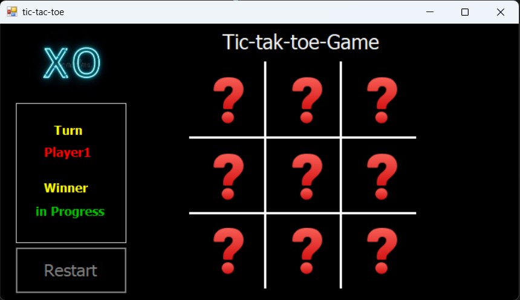

# Tic-Tac-Toe Game

## About the Project

Tic-Tac-Toe is a Windows desktop game built with **C#** and **Windows Forms**. Two players take turns on a 3×3 board: Player 1 uses **X**, and Player 2 uses **O**.

## Features

- Two-player gameplay on the same computer.
- Alternating turns between Player 1 (X) and Player 2 (O).
- Detects winning combinations across rows, columns, and diagonals.
- Highlights the winning cells and displays the winner.
- Announces the end of the game when a player wins.

## Technologies Used

- C#
- Windows Forms
- .NET Framework 4.8
- Visual Studio

## How to Run

1. Download or clone the project repository.
2. Open `tic-tac-toe.sln` in Visual Studio.
3. Build the solution.
4. Run the application.

## How to Play

1. Player 1 starts with **X**.
2. Player 2 takes the next turn with **O**.
3. Players take turns selecting empty cells on the 3×3 board.
4. The first player to place three matching symbols in a row, column, or diagonal wins.

---

*Created as a C# Windows Forms practice project.*
